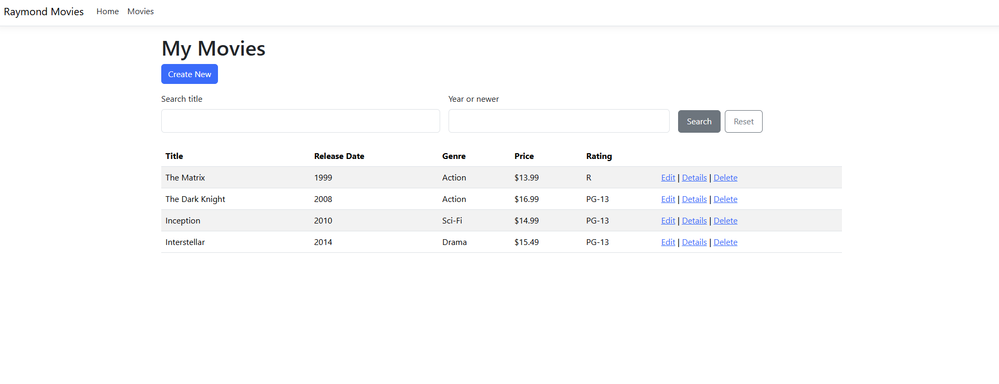

# CSE325-CSharp

## Working site

## Week 02: ASP.NET Core MVC Movie app

This project contains the ASP.NET Core MVC movie application created in Week 02, including:

- custom app title: Raymond Movies
- seeded movie data
- title search and year-based filtering
- create, edit, details, and delete functionality
- padded form styling for input controls

The working site screenshot above shows the movie listing page with the app title and search/filter controls.
