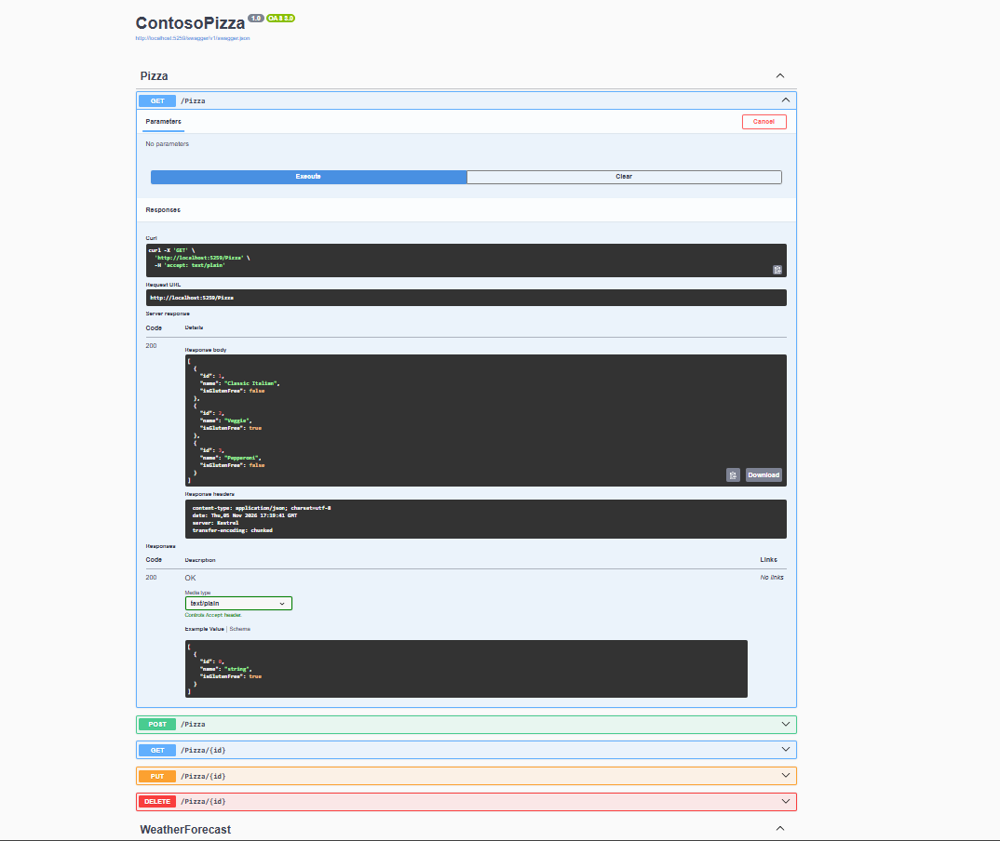

# W01 .NET Applications — Submission Notes

working site img: 

The working code is in [`Practice/W01-DotNetApplications`](./Practice/W01-DotNetApplications/):

- `ContosoPizza` is the .NET 8 ASP.NET Core controller API.
- `SalesSummary` is the .NET 8 sales-report console app.

## 1. Pizza API evidence and request/response results

Run the API from `Practice/W01-DotNetApplications/ContosoPizza` with
`dotnet run`. The HTTP profile is `http://localhost:5259`. Swagger is available
at `http://localhost:5259/swagger` while the app runs in Development.

The seed data includes the original Classic Italian and Veggie pizzas plus the
additional Pepperoni pizza. A live `GET /pizza` request returned `200 OK` and:

```json
[
  { "id": 1, "name": "Classic Italian", "isGlutenFree": false },
  { "id": 2, "name": "Veggie", "isGlutenFree": true },
  { "id": 3, "name": "Pepperoni", "isGlutenFree": false }
]
```

The following requests and results were verified against the running API:

### GET all pizzas

Request sent:

```http
GET /pizza
Accept: application/json
```

Response received: `200 OK`, with the three-pizza JSON list shown above.

### GET a pizza by ID

Request sent:

```http
GET /pizza/1
Accept: application/json
```

Response received: `200 OK`

```json
{ "id": 1, "name": "Classic Italian", "isGlutenFree": false }
```

### POST a pizza

Request sent:

```http
POST /pizza
Content-Type: application/json

{ "name": "Hawaii", "isGlutenFree": false }
```

Response received: `201 Created`, with a `Location` header pointing to
`/Pizza/4` and this response body:

```json
{ "id": 4, "name": "Hawaii", "isGlutenFree": false }
```

### PUT an updated pizza

Request sent:

```http
PUT /pizza/4
Content-Type: application/json

{ "id": 4, "name": "Hawaiian", "isGlutenFree": false }
```

Response received: `204 No Content`. A follow-up `GET /pizza/4` returned
`200 OK` with the updated name `Hawaiian`.

### DELETE a pizza

Request sent:

```http
DELETE /pizza/4
```

Response received: `204 No Content`. A follow-up `GET /pizza/4` returned
`404 Not Found`, confirming the pizza was removed.

These requests, including missing-ID checks, are also in
[`ContosoPizza.http`](./Practice/W01-DotNetApplications/ContosoPizza/ContosoPizza.http).
Send the POST, PUT, and DELETE requests in that order during the same app
session; the POST creates ID 4 for the following operations. Restarting the
app resets its in-memory data.

## 2. Sales summary report

Run the console app from `Practice/W01-DotNetApplications/SalesSummary` with
`dotnet run`. It reads each non-empty line in each `.txt` file under `SalesData`
as an invariant-culture sales amount, reports every file's total and the grand
total, and formats the amounts as currency. Invalid sales lines raise a
`FormatException` that identifies the file and line number.

The included sample files produce:

```text
Sales Summary
------------------------------
Total Sales: $5,421.00

Details:
  February.txt: $2,875.25
  January.txt: $2,545.75
```

Working sales-summary function (`Program.cs`):

```csharp
static string GenerateSalesSummary(string directory, CultureInfo currencyCulture)
{
    if (!Directory.Exists(directory))
    {
        throw new DirectoryNotFoundException($"Sales data directory was not found: {directory}");
    }

    var report = new StringBuilder();
    var files = Directory.GetFiles(directory, "*.txt").Order(StringComparer.OrdinalIgnoreCase);
    decimal totalSales = 0;
    var fileTotals = new List<(string FileName, decimal Total)>();

    foreach (var file in files)
    {
        decimal fileTotal = 0;
        var lineNumber = 0;

        foreach (var line in File.ReadLines(file))
        {
            lineNumber++;
            if (string.IsNullOrWhiteSpace(line))
            {
                continue;
            }

            if (!decimal.TryParse(line, NumberStyles.Currency, CultureInfo.InvariantCulture, out var amount))
            {
                throw new FormatException($"Invalid sales amount in {Path.GetFileName(file)} at line {lineNumber}: '{line}'.");
            }

            fileTotal += amount;
        }

        fileTotals.Add((Path.GetFileName(file), fileTotal));
        totalSales += fileTotal;
    }

    report.AppendLine("Sales Summary");
    report.AppendLine("------------------------------");
    report.AppendLine($"Total Sales: {totalSales.ToString("C", currencyCulture)}");
    report.AppendLine();
    report.AppendLine("Details:");

    foreach (var (fileName, total) in fileTotals)
    {
        report.AppendLine($"  {fileName}: {total.ToString("C", currencyCulture)}");
    }

    return report.ToString();
}
```
